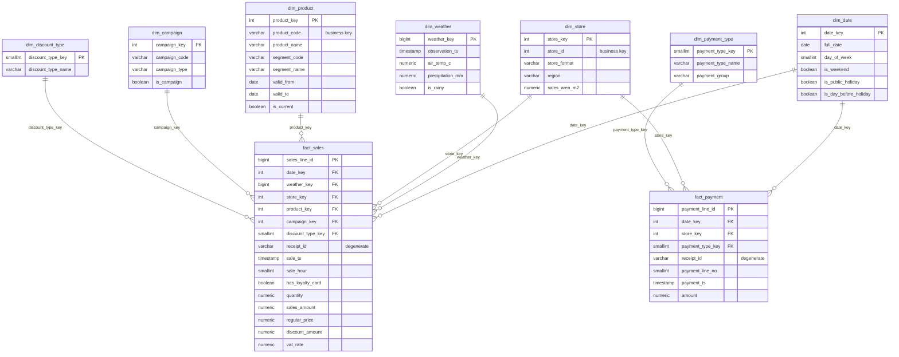

# Data model – star schema

Two fact tables share conformed dimensions (a small *fact constellation*). `fact_sales` is the main fact; `fact_payment` exists because payments belong to the receipt, not to individual product lines.

## Grain

- **fact_sales:** one row = **one product line on one receipt** (one scan event at the till). This is the lowest level available in the POS file, so any aggregate (receipt, hour, day, segment) can be derived from it.
- **fact_payment:** one row = **one payment line of a receipt** (payment method + amount). A receipt has one or more rows: in the sample day 2,610 receipts produced 2,714 payment lines, because some receipts were paid with several methods (e.g. card + gift card).
- The two facts are linked through the degenerate dimension `receipt_id` (store–till–receipt number–date), which also lets us compute basket size and basket value.

## Slowly Changing Dimensions

| Dimension | SCD type | Reasoning |
|---|---|---|
| `dim_product` | **Type 2** | Products are regularly renamed and moved between segments (category management). Sales must be reported under the segment that was valid *at the time of sale*, otherwise historical category trends would change retroactively. Tracked attributes: `product_name`, `segment_code`, `segment_name`. The regular price changes too often to be an SCD attribute; it is stored as a measure in the fact (`regular_price`). |
| `dim_store` | **Type 1** | Store attributes (area, number of self-checkouts, opening hours) change rarely and are mostly corrections. With a single store, keeping history adds no analytical value, so changes are overwritten. |
| `dim_campaign` | **Type 1** | A campaign's status changes from *active* to *ended/cancelled* (XSD classifier); only the latest status matters, so it is overwritten. The campaign period itself is visible through the sales dates. |
| `dim_date` | **Static** | Generated calendar; values never change. Holiday flags come from the public holiday list. |
| `dim_weather` | **Static** | Historical observations do not change after they are recorded. |
| `dim_discount_type` | **Static** | Fixed list of generic discount categories (free-text names are mapped during anonymisation). New categories add rows. |
| `dim_payment_type` | **Static** | Fixed code list from the XSD. A new XSD version would add rows, not change existing ones. |
