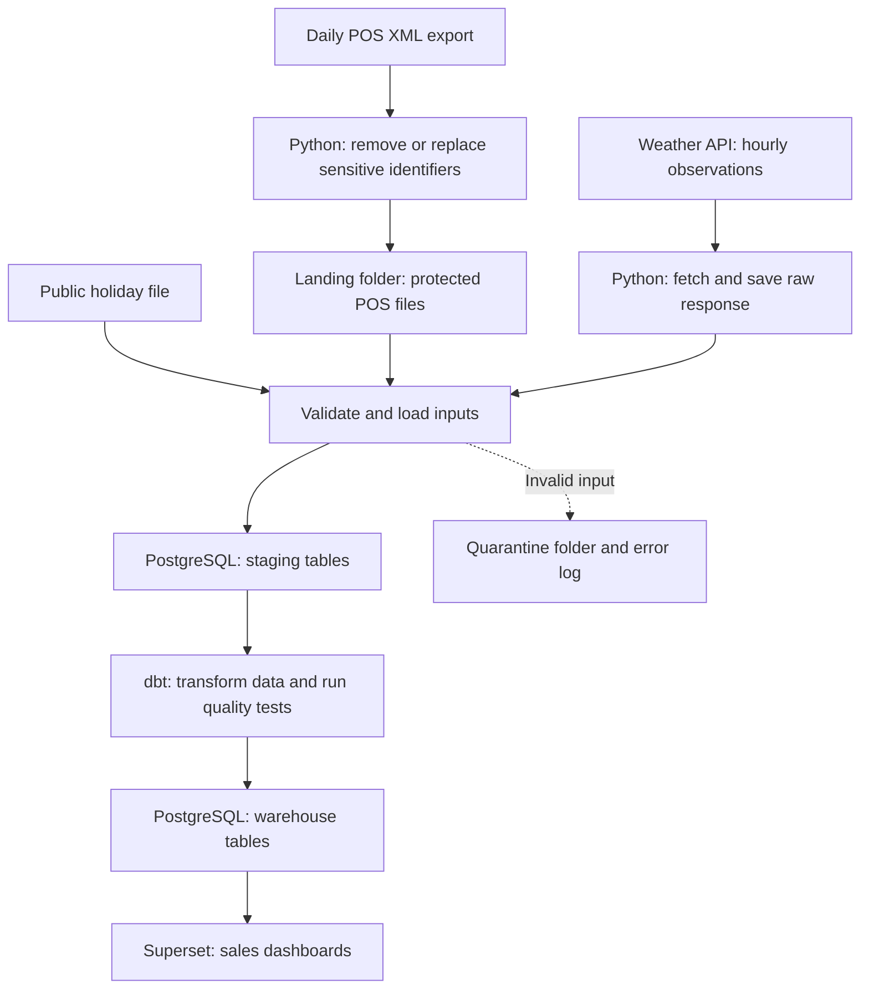

# Architecture draft

## Main idea

Once a day, combine the store's sales data with hourly weather observations and calendar information. Keep the original inputs, prepare them in PostgreSQL, and build the existing star schema for reports about sales, products, weather, and holidays.

## Architecture scheme

Airflow coordinates the daily steps, including retries and failure reporting. It is the scheduler around this flow, not another place where data is stored. Docker Compose provides the local environment.

## Tools to be used

| Step | Tool | Explanation |
|---|---|---|
| Protect POS data | Python + lxml | Remove or replace sensitive identifiers locally, before files enter the shared pipeline. Keep XML compatible with the XSD. |
| Collect inputs | Python, scheduled by Airflow | Read the daily POS file, fetch the previous day's hourly weather, and load the holiday calendar when updated. |
| Keep source copies | Local folders | Save protected XML and raw weather responses so a failed load can be investigated or repeated. Unprotected POS files stay outside the shared pipeline and GitHub. |
| Validate and stage | Python + PostgreSQL | Validate XML against XSD v26, parse the inputs, and load the existing `staging` tables. Staging is a structured copy of the input data. |
| Build the model | dbt + PostgreSQL | Create dimensions first, then `fact_sales` and `fact_payment`. Link sales to the correct product version, calendar date, and weather hour. |
| Report | Superset | Read validated warehouse tables to explore sales trends, product segments, campaigns, and weather associations. |

Staging and warehouse tables use separate schemas in the same PostgreSQL database.

## When data is loaded

- **POS:** one batch each day, after the previous day's export is available.
- **Weather:** hourly observations retrieved in a daily batch for the same period. Historical access and available fields still need verification.
- **Holidays:** load initially and refresh annually or when the source changes.
- **Reports:** make the new batch available after required checks pass. On failure, retain the last successful data and show its refresh time.

## Data quality checks

| Check | Why it matters | On failure |
|---|---|---|
| Expected POS file exists and passes XSD validation | Detect missing exports or broken XML before parsing. | Log a missing file, or quarantine invalid XML; stop that batch. |
| Sales-line identifiers are unique and required fields are present | Prevent duplicates and unusable sales records. | Stop the affected load. Re-running a file must not add its sales twice. |
| Each sale matches exactly one valid product version; product validity periods do not overlap | Keep historical product reporting correct and prevent duplicated sales after joins. | Block the new warehouse batch. |
| Sales row counts and totals agree between staging and warehouse | Detect lost or multiplied records during transformation. | Block the new warehouse batch if differences are unexplained. |
| Weather has one observation per station and hour, valid ranges, and measured coverage | Prevent ambiguous joins and detect missing or invalid weather. | Resolve duplicates before joining; flag missing or invalid observations and keep the sales with weather marked unknown. |